<div align="center">

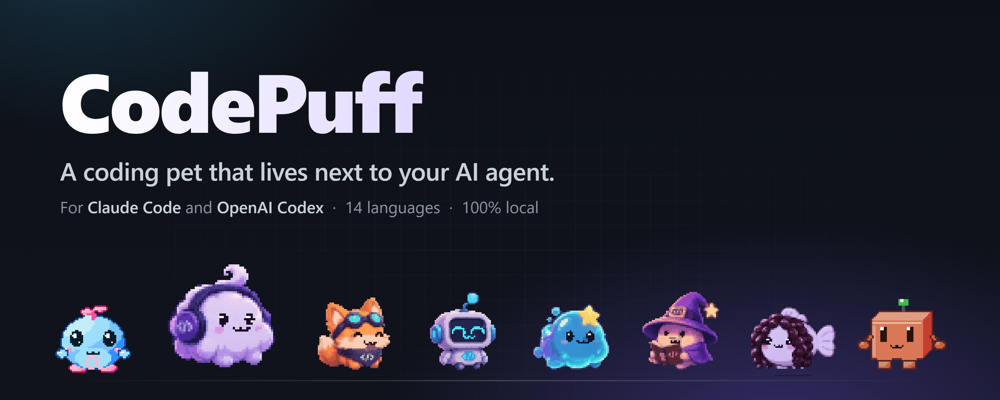

<br>

[](https://github.com/luizbizzio/codepuff/actions/workflows/ci.yml)
[](CHANGELOG.md)
[](LICENSE)
[](https://nodejs.org)
[](package.json)
[](docs/FEATURES.md#languages)
[](#privacy)

**[Install](#install)** &nbsp;&middot;&nbsp; **[What you see](#what-you-see)** &nbsp;&middot;&nbsp; **[The pets](#the-pets)** &nbsp;&middot;&nbsp; **[Claude Code and Codex](#claude-code-and-codex)** &nbsp;&middot;&nbsp; **[Privacy](#privacy)** &nbsp;&middot;&nbsp; **[FAQ](#faq)** &nbsp;&middot;&nbsp; **[Docs](#documentation)**

</div>

<br>

An AI agent can work for minutes at a time, and a blinking cursor tells you nothing about it. CodePuff puts a small pixel-art
companion next to your agent that shows **what it is really doing**: reading, searching, typing, running tests, waiting for you,
failing. It celebrates only when a test run really passed, and it keeps a running record of your work across sessions and across
both agents.

<p align="center">
  
</p>

<p align="center"><sub>The compact band above the Claude Code prompt (large size, English), with the plan limits under it.</sub></p>

<table align="center">
  <tr>
    <td align="center"></td>
    <td align="center"></td>
    <td align="center"></td>
    <td align="center"></td>
    <td align="center"></td>
    <td align="center"></td>
  </tr>
  <tr>
    <td align="center"><sub>Thinking</sub></td>
    <td align="center"><sub>Coding</sub></td>
    <td align="center"><sub>Reading</sub></td>
    <td align="center"><sub>Testing</sub></td>
    <td align="center"><sub>Success</sub></td>
    <td align="center"><sub>Waiting for you</sub></td>
  </tr>
</table>


## Why CodePuff

- **Honest.** Every animation comes from a real event. The success dance needs a test run that exited with code 0; the error face needs a tool that really failed. When CodePuff cannot know something, it says so instead of guessing.
- **Alive.** Thinking, reading, searching, editing, testing, delegating: each has its own scene, and long waits keep changing (a glance, a blink, a bright idea, and a quirk of each character), so it never looks frozen.
- **Yours.** Eight characters, fourteen palettes (some of them earned) or your own colors, accessories and frames, your own name, quiet sounds, three levels of motion, and 14 languages picked automatically from your computer.
- **Playful.** Game-style achievement badges that level up from bronze to diamond and unlock accessories, colors and frames; greetings for the time of day; a pet that gets bored, has a coffee and naps; and, if you want it, a reminder to take a break.
- **Private.** One local folder. No account, no server, no telemetry, no model calls, no network code at all. Only counters are stored: never your prompts, code or paths.
- **Light.** Zero dependencies and nothing to build. Each hook is a tiny process that writes one small file.

## Install

### Claude Code

Inside Claude Code, send these **one at a time**, then open a new session (or run `/reload-plugins`):

```text
/plugin marketplace add luizbizzio/codepuff
```

```text
/plugin install codepuff@codepuff
```

<sub>CodePuff runs on the computer where your Claude Code session runs, so use a local session (in the desktop app, **This computer**). Do not add it from the app's Settings, Plugins screen: it can refuse CodePuff.</sub>

### Codex &nbsp;<sub>needs <a href="https://nodejs.org">Node.js</a> 20+</sub>

**1.** In a terminal: `npx github:luizbizzio/codepuff setup --only codex`

**2.** In Codex, open **Review hooks** (CLI: `/hooks`) and click **Trust all**. ⚠ Nothing works before this.

**3.** To see the pet, run `npx github:luizbizzio/codepuff pet` in a second terminal.

<sub>Claude Code is the fuller experience: the pet sits above the prompt and tool results are counted. Codex has no screen for plugins, so its pet shows in that terminal, and Codex does not report how a tool call ended ([details](#claude-code-and-codex)). Other ways to install, checking it ✔ (`doctor`), updating and uninstalling: [docs/INSTALL.md](docs/INSTALL.md).</sub>

## What you see

<!-- states:start (generated by scripts/characters.mjs) -->

Foxy in every state, as the animated pictures the band draws:

<div align="center">

<table>
  <tr>
    <td align="center"><br><sub>Idle</sub></td>
    <td align="center"><br><sub>Bored</sub></td>
    <td align="center"><br><sub>Coffee break</sub></td>
    <td align="center"><br><sub>Napping</sub></td>
    <td align="center"><br><sub>Thinking</sub></td>
    <td align="center"><br><sub>Reading</sub></td>
  </tr>
  <tr>
    <td align="center"><br><sub>Searching</sub></td>
    <td align="center"><br><sub>Investigating</sub></td>
    <td align="center"><br><sub>Coding</sub></td>
    <td align="center"><br><sub>Running</sub></td>
    <td align="center"><br><sub>Git</sub></td>
    <td align="center"><br><sub>Connected tool</sub></td>
  </tr>
  <tr>
    <td align="center"><br><sub>Testing</sub></td>
    <td align="center"><br><sub>Web</sub></td>
    <td align="center"><br><sub>Subagents</sub></td>
    <td align="center"><br><sub>Planning</sub></td>
    <td align="center"><br><sub>Success</sub></td>
    <td align="center"><br><sub>Error</sub></td>
  </tr>
  <tr>
    <td align="center">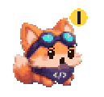<br><sub>Needs you</sub></td>
    <td align="center"><br><sub>Waiting</sub></td>
    <td align="center"><br><sub>Finished</sub></td>
    <td align="center"><br><sub>Tired</sub></td>
    <td align="center"><br><sub>Sad</sub></td>
    <td align="center"><br><sub>Disconnected</sub></td>
  </tr>
  <tr>
    <td align="center"><br><sub>Petted</sub></td>
    <td align="center"><br><sub>Giggle</sub></td>
    <td align="center"><br><sub>Delighted</sub></td>
    <td align="center"><br><sub>Good morning</sub></td>
    <td align="center"><br><sub>Good afternoon</sub></td>
    <td align="center"><br><sub>Good evening</sub></td>
  </tr>
  <tr>
    <td align="center"><br><sub>Late night</sub></td>
    <td align="center"><br><sub>Stretch</sub></td>
  </tr>
</table>

</div>

<!-- states:end -->

| The pet shows | When |
| --- | --- |
| A thought cloud, a light bulb, then a turning gear | The agent is working on a response |
| A book with its eyes sweeping the lines, or a magnifier | Reading files, searching the project |
| A laptop with floating code, or a shell with a spinner | Editing code, running a command |
| A commit graph, or a plug sliding into a socket | A git command, a tool from an MCP server |
| A bubbling flask | A test run is in flight |
| Sparkles | A test run was confirmed passed, or a commit was made |
| A red badge (Foxy also floats a 404) | Something really failed |
| A yellow badge, hands up | The agent needs you: an approval or a question |
| Confetti, then a happy face | The turn is done and it waits for your next prompt |
| Half-closed eyes and a sweat drop | Your plan's limit is nearly used up |

When subagents run, small helpers appear. With several sessions open, one fixed rule decides which one the pet shows, and the
label always says which agent and which project it is.

### The four tabs

Type `/codepuff` in Claude Code to open the pane. Its four tabs, from left to right (a chart, a palette, a trophy and a gear), are below; the camera button at the right saves a **pet card**.

<table>
  <tr>
    <td width="50%" align="center"></td>
    <td width="50%" align="center"></td>
  </tr>
  <tr>
    <td align="center"><sub><b>Statistics</b>: pick a platform and a period; the numbers that matter, and every number one button away.</sub></td>
    <td align="center"><sub><b>Customize</b>: name, character, colors, accessory and band frame. What is still locked shows a padlock.</sub></td>
  </tr>
  <tr>
    <td width="50%" align="center">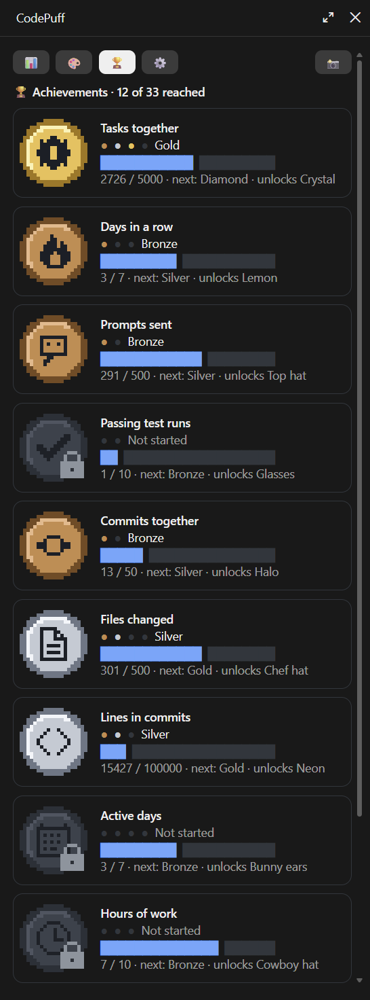</td>
    <td width="50%" align="center">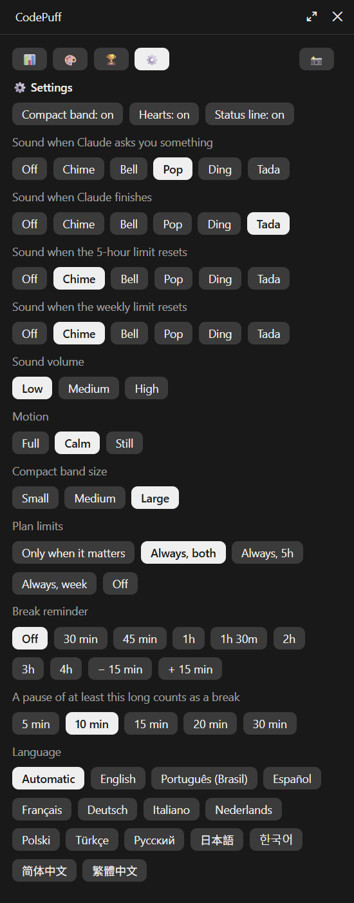</td>
  </tr>
  <tr>
    <td align="center"><sub><b>Achievements</b>: medals that level up from bronze to diamond, with your progress and what comes next.</sub></td>
    <td align="center"><sub><b>Settings</b>: sounds, motion, band size, plan limits, break reminder and language.</sub></td>
  </tr>
</table>

Statistics are counted, never guessed: prompts, turns, tool calls (succeeded and failed), files changed, tests run, commits, lines
added and deleted, agent time, subagents, streaks and a daily chart, by **platform** (Claude Code, Codex or both) and **period** (this
session, 7 days, 30 days, all time). The session's cost is the host's own estimate, marked with a `≈`. Round numbers, such as the
hundredth task or a seven day streak, get a small celebration, once each.

### Achievements and rewards

Every level of every achievement unlocks something, so there is always a next thing to work toward:

- **Eleven medals** for what is really counted: tasks, days in a row, prompts, passing test runs, commits, files changed, lines in commits, active days, hours of work, helpers called and projects. Each goes from bronze to silver, gold and diamond.
- **Seventeen accessories** to wear, from a flower to a crown, a pirate hat and a Viking helmet, placed to fit every character.
- **Fourteen color palettes**: five are free, nine are earned. A color of your own is always free.
- **Band frames** around the compact band and the pet card: the rainbow one is yours from the start, and seven more are earned.

What a pet had reached before is unlocked quietly, with no pile of messages.

### A pet with something to do

When nothing happens the pet gets bored, has a coffee and naps, and it greets you for the time of day. If you like, it reminds you to take a **break** after a long stretch of work (you choose how long). A thin strip under the band shows your plan's **5-hour** and **weekly** limits, and the status line shows what the pet is doing with the context used and the cost. Save a **pet card**, an animated picture with the pet and a few of its numbers, to share. See [Features](docs/FEATURES.md).

### Hearts and sounds

The pet has one to five **hearts** for you, kept between sessions. Be kind and it beams; be abusive to the assistant and the hearts
drop and it gets sad. Swearing at a bug is fine, and harsh feedback on the work only makes it flinch. A prompt is read in memory to
tell the difference, then dropped: only a number is kept, and one switch turns the whole thing off.

Short, original **sounds** play when the agent asks you something, when a turn finishes, and when your 5-hour or weekly limit resets.
Each can be changed or silenced, and they start quiet.

### Fourteen languages

Everything CodePuff says is translated and follows your computer's language by itself: English, Portuguese (Brazil), Spanish, French,
German, Italian, Dutch, Polish, Turkish, Russian, Japanese, Korean, Simplified Chinese and Traditional Chinese. Change it in Settings,
with `/codepuff language`, or `codepuff set language`. Details in [docs/FEATURES.md](docs/FEATURES.md#languages).

## The pets

<!-- pets:start (generated by scripts/characters.mjs) -->

| Pet | Character | Personality |
| --- | --- | --- |
| <a href="docs/characters/classic.md"></a> | **[Classic](docs/characters/classic.md)** (default) | A fluffy code cloud with headphones. Bounces when it is happy. |
| <a href="docs/characters/alpha.md"></a> | **[Alpha](docs/characters/alpha.md)** | The original CodePuff: a round, soft puff with a sprout. Waves hello. |
| <a href="docs/characters/fox.md"></a> | **[Foxy](docs/characters/fox.md)** | A curious explorer with goggles. Sniffs around, and floats a 404 over its head when something fails. |
| <a href="docs/characters/bot.md"></a> | **[Bot](docs/characters/bot.md)** | A tidy little robot with a screen face. Scans left and right, status light blinking. |
| <a href="docs/characters/slime.md"></a> | **[Slime](docs/characters/slime.md)** | A glossy, bouncy code slime with a lucky star. Wobbles. |
| <a href="docs/characters/mage.md"></a> | **[Mage](docs/characters/mage.md)** | A tiny programming wizard with a book of spells. Sparks while it thinks. |
| <a href="docs/characters/aquatic.md"></a> | **[Penny](docs/characters/aquatic.md)** | A deep-sea puffer with curly dark hair. Floats and sways her fin. |
| <a href="docs/characters/claude.md"></a> | **[Claude](docs/characters/claude.md)** | A boxy orange critter (an unofficial fan design). Shuffles its feet. |

Click a character to see all of its animations and when each one appears.

<!-- pets:end -->

Every character wears any palette, has its own way of idling, thinking and waiting, and every expression the others have.

## Claude Code and Codex

One pet, one set of settings and one history, shared by both. What differs is what each host lets a plugin do:

| | Claude Code | Codex |
| --- | --- | --- |
| Pet and band above the prompt, pane, status line, sounds, toasts | Yes | No: Codex has no plugin screen |
| Terminal app (`codepuff pet`): pet, statistics, customization | Yes | Yes |
| Prompts, turns, tool calls, sessions, time | Yes | Yes |
| Tool results (passed, failed), test results, commits | Yes | Not reported by the Codex build checked, so those calls are counted with an *unknown* outcome |
| Plan limits (the tired pet, reset sounds) | Yes | No |

CodePuff keeps its word here: nothing is shown for Codex that Codex did not report. If a later Codex sends tool completions, they are
used automatically. What was verified on which system is listed in [docs/STATUS.md](docs/STATUS.md).

## Privacy

Everything stays on your computer, in one folder (`~/.codepuff`). No account, no server, no model calls, no telemetry. Only
**counters** are stored: never your prompts, code, commands, file paths or tool output (tested with sentinel strings). The single place
a prompt is read is the hearts: its text is judged in memory, then dropped. Switch that off (*Hearts* in
Settings, or `/codepuff mood off`) and nothing is read at all. Export, import, reset or delete your data any time with `codepuff data`.
See [SECURITY.md](SECURITY.md).

## FAQ

**Does it slow my agent down?** No. The hook is a tiny Node process that writes one small file. Measured numbers are in
[docs/PERFORMANCE.md](docs/PERFORMANCE.md).

**Does it send anything anywhere?** No. There is no network code.

**Can I use it with Claude Code and Codex at once?** Yes, that is the point: they share the pet and the statistics. Install it in Codex
one way only (the plugin, or `codepuff install codex`), or every event is counted twice. `codepuff doctor` warns you if you did both.

**The terminal app says "waiting for an agent".** The agent has not run a hook yet. For Codex, trust the hooks (`/hooks`), then send a prompt.

**How do I change the pet?** `/codepuff`, then **Customize**. Or `/codepuff character fox`, or `codepuff set character fox`.

**Is it affiliated with Anthropic or OpenAI?** No. It is an independent project, and "Claude" is an unofficial fan design.

## Documentation

| Page | What it covers |
| --- | --- |
| [Install](docs/INSTALL.md) | Other ways to install, updating, troubleshooting |
| [Features](docs/FEATURES.md) | Every state, surface, setting (with its default), language and statistic, and the commands |
| [Architecture](docs/ARCHITECTURE.md) | How it is built, the data model, concurrency, adding a character |
| [Platforms](docs/PLATFORMS.md) | What Claude Code and Codex expose, and what only one of them can do |
| [Status](docs/STATUS.md) | What was verified where, known limitations, what comes next |
| [Performance](docs/PERFORMANCE.md) | Measured overhead, and how |
| [Development](docs/DEVELOPMENT.md) | Tests, tools, CI, the art and sound pipelines |
| [Changelog](CHANGELOG.md), [Contributing](CONTRIBUTING.md), [Security](SECURITY.md) | Releases, how to help, reporting problems |

## About this version

1.1.0 builds on 1.0.0: the engine, the Claude Code mod, the terminal app and the installers are complete, documented and covered by tests, on
Windows, macOS and Linux in CI. It does not mean everything was verified everywhere: the Claude Code mod has only been run by hand
on Windows, the translations were written by the project rather than by native speakers, and Codex support works within what the
Codex hooks report. [docs/STATUS.md](docs/STATUS.md) lists exactly what was and was not checked.

## Contributing

Bug reports, ideas, translations and new characters are welcome: see [CONTRIBUTING.md](CONTRIBUTING.md). A character is pixel art plus
a few lines of description, and a language is one file; the engine does the rest.

## License

Apache License 2.0: see [LICENSE](LICENSE) and [NOTICE](NOTICE). CodePuff is independent and not affiliated with Anthropic or OpenAI.
Alpha is drawn in code, "Claude" is an unofficial fan design, and the six other characters are pixel-art conversions of images the
project owner created with an AI image generator (see [NOTICE](NOTICE)).

<p align="center"><sub>Made by <a href="https://github.com/luizbizzio">Luiz Bizzio</a>.</sub></p>
