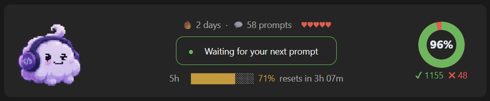
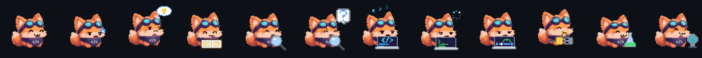
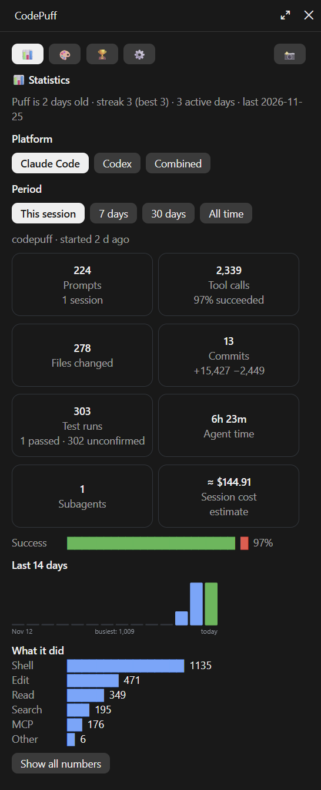
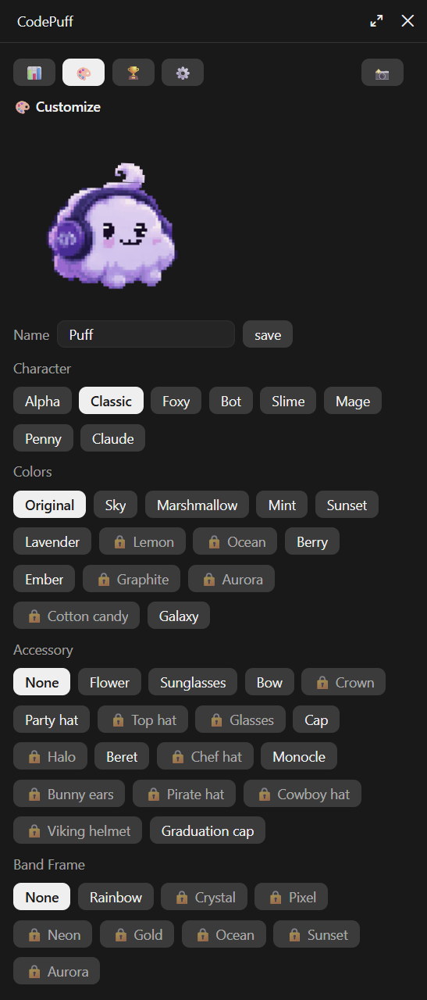

 

**[Install](#install)** &nbsp;&middot;&nbsp; **[What you see](#what-you-see)** &nbsp;&middot;&nbsp; **[The pets](#the-pets)** &nbsp;&middot;&nbsp; **[Claude Code and Codex](#claude-code-and-codex)** &nbsp;&middot;&nbsp; **[Privacy](#privacy)** &nbsp;&middot;&nbsp; **[FAQ](#faq)** &nbsp;&middot;&nbsp; **[Docs](#documentation)**

 

An AI agent can work for minutes at a time, and a blinking cursor tells you nothing about it. CodePuff puts a small pixel-art
companion next to your agent that shows **what it is really doing**: reading, searching, typing, running tests, waiting for you,
failing. It celebrates only when a test run really passed, and it keeps a running record of your work across sessions and across
both agents.

  

The compact band above the Claude Code prompt (large size, English).

## Why CodePuff

- **Honest.** Every animation comes from a real event. The success dance needs a test run that exited with code 0; the error face needs a tool that really failed. When CodePuff cannot know something, it says so instead of guessing.
- **Alive.** Thinking, reading, searching, editing, testing, delegating: each has its own scene, and long waits keep changing (a glance, a blink, a bright idea, and a quirk of each character), so it never looks frozen.
- **Yours.** Eight characters, ten palettes or your own colors, your own name, quiet sounds, three levels of motion, and 14 languages picked automatically from your computer.
- **Private.** One local folder. No account, no server, no telemetry, no model calls, no network code at all. Only counters are stored: never your prompts, code or paths.
- **Light.** Zero dependencies and nothing to build. Each hook is a tiny process that writes one small file.

## Install

Pick the agent you use. Nothing to build, nothing to configure.

### Claude Code

**No Node.js needed.** Type these two lines inside Claude Code, then start a new session:

\
In the desktop app: **+** next to the prompt, then **Plugins**, then **Add marketplace**. The pet appears above the prompt, and  opens its pane.

### Codex

**Needs [Node.js](https://nodejs.org) 20 or newer** (CodePuff's hooks are small Node programs; Codex users usually have it already). In a terminal:

\
Then trust the hooks once, because Codex never runs new hooks without asking: type  in the CLI, or use **Review hooks** in the desktop app.

Codex has no plugin screen to draw on, so to watch the pet open the terminal app next to it (also needs Node.js 20+):

\                                    
                                    
                                    
                   ▄▄▄▄             
                  ▀▀▀▀▀▀            
             ▄▄▄▄▀▀▀▀▀▀▀            
          ▄▀▀▀▀▀▀▀▀▀▀▀▀▀▄▄          
        ▄▀▀▀▀▀▀▀▀▀▀▀▀▀▀▀▀▀▄         
       ▄▀▀▀▀▀▀▀▀▀▀▀▀▀▀▀▀▀▀▀▄        
      ▄▀▀▀▀▀▀▀▀▀▀▀▀▀▀▀▀▀▀▀▀▀▀       
      ▀▀▀▀▀▀▀▀▀▀▀▀▀▀▀▀▀▀▀▀▀▀▀▄      
       ▀▀▀▀▀▀▀▀▀▀▀▀▀▀▀▀▀▀▀▀▀▀▀      
       ▀▀▀▀▀▀▀▀▀▀▀▀▀▀▀▀▀▀▀▀▀▀▀      
       ▀▀▀▀▀▀▀▀▀▀▀▀▀▀▀▀▀▀▀▀▀        
          ▀ ▀▀▀▀▀▀▀▀▀▀▀▀▀▀▀         
                                    
                                    
### Both at once (optional, needs Node.js 20+)

One command installs CodePuff in whichever of the two it finds, by running the commands above for you:

\Claude Code
  the claude command was not found. In Claude Code, type:
    /plugin marketplace add luizbizzio/codepuff
    /plugin install codepuff@codepuff

Codex
  the codex command was not found. In a terminal where Codex runs, type:
    codex plugin marketplace add luizbizzio/codepuff
    codex plugin add codepuff@codepuff

Check it any time with: npx github:luizbizzio/codepuff doctor
### Check it works (needs Node.js 20+)

\CodePuff doctor
  ok    Node.js — v26.9.0
  ok    data folder — C:UsersLuiz.codepuff
  ok    pet — classic (classic)
  ok    statistics — 1 sessions, 2 files, 6.0 KB
  ok    hook errors — none logged
  ok    git — git version 2.56.1.windows.1
  warn  Codex — CodePuff is not installed in Codex: run "codex plugin marketplace add luizbizzio/codepuff" and then "codex plugin add codepuff@codepuff"
  warn  Claude Code — the CodePuff plugin is not enabled: in Claude Code run "/plugin marketplace add luizbizzio/codepuff" and then "/plugin install codepuff@codepuff"
It reports whether CodePuff is installed in Claude Code and in Codex, and what to do if it is not. Other routes (from a clone), updating, uninstalling and troubleshooting are in [docs/INSTALL.md](docs/INSTALL.md).

## What you see

  

  

| The pet shows | When |
| --- | --- |
| A thought cloud, a light bulb, then a turning gear | The agent is working on a response |
| A book with its eyes sweeping the lines, or a magnifier | Reading files, searching the project |
| A laptop with floating code, or a shell with a spinner | Editing code, running a command |
| A commit graph, or a plug sliding into a socket | A git command, a tool from an MCP server |
| Goggles and a bubbling flask | A test run is in flight |
| Sparkles | A test run was confirmed passed, or a commit was made |
| A red badge (Foxy also floats a 404) | Something really failed |
| A yellow badge, hands up | The agent needs you: an approval or a question |
| Confetti, then a happy face | The turn is done and it waits for your next prompt |
| Half-closed eyes and a sweat drop | Your plan's limit is nearly used up |

When subagents run, small helpers appear. With several sessions open, one fixed rule decides which one the pet shows, and the
label always says which agent and which project it is.

### Statistics and customization

<table>
  <tr>
    <td width="50%" align="center"></td>
    <td width="50%" align="center"></td>
  </tr>
  <tr>
    <td align="center"><b>Statistics</b>: a platform, a period, the numbers that matter, and every number one button away.</td>
    <td align="center"><b>Customize</b>: character, colors, sounds, motion, size and language.</td>
  </tr>
</table>

Statistics are counted, never guessed: prompts, turns, tool calls (succeeded and failed), files changed, tests run, commits, lines
added and deleted, agent time, streaks and a daily chart, by **platform** (Claude Code, Codex or both) and **period** (this session,
7 days, 30 days, all time). Round numbers, such as the hundredth task or a seven day streak, get a small celebration, once each.

### Hearts and sounds

The pet has one to five **hearts** for you, kept between sessions. Be kind and it beams; be abusive to the assistant and the hearts
drop and it gets sad. Swearing at a bug is fine, and harsh feedback on the work only makes it flinch. A prompt is read in memory to
tell the difference, then dropped: only a number is kept, and one switch turns the whole thing off.

Short, original **sounds** play when the agent asks you something, when a turn finishes, and when your 5-hour or weekly limit resets.
Each can be changed or silenced, and they start quiet.

### Fourteen languages

Everything CodePuff says is translated and follows your computer's language by itself: English, Portuguese (Brazil), Spanish, French,
German, Italian, Dutch, Polish, Turkish, Russian, Japanese, Korean, Simplified Chinese and Traditional Chinese. Change it in Customize,
with `/codepuff language`, or `codepuff set language`. Details in [docs/FEATURES.md](docs/FEATURES.md#languages).

## The pets

  

| Character | Personality |
| --- | --- |
| **Classic** (default) | A fluffy code cloud with headphones. Bounces when it is happy. |
| **Alpha** | The original CodePuff: a round, soft puff with a sprout. Waves hello. |
| **Foxy** | A curious explorer with goggles. Sniffs around, and floats a 404 over its head when something fails. |
| **Bot** | A tidy little robot with a screen face. Scans left and right, status light blinking. |
| **Slime** | A glossy, bouncy code slime with a lucky star. Wobbles. |
| **Mage** | A tiny programming wizard with a book of spells. Sparks while it thinks. |
| **Penny** | A deep-sea puffer with curly dark hair. Floats and sways her fin. |
| **Claude** | A boxy orange critter (an unofficial fan design). Shuffles its feet. |

Every character wears any palette, has its own way of idling, thinking and waiting, and every expression the others have.

## Claude Code and Codex

One pet, one set of settings and one history, shared by both. What differs is what each host lets a plugin do:

| | Claude Code | Codex |
| --- | --- | --- |
| Pet and band above the prompt, pane, status line, sounds, toasts | Yes | No: Codex has no plugin screen |
| Terminal app (`codepuff pet`): pet, statistics, customization | Yes | Yes |
| Prompts, turns, tool calls, sessions, time | Yes | Yes |
| Tool results (passed, failed), test results, commits | Yes | Not reported by the Codex build checked, so those calls are counted with an *unknown* outcome |
| Plan limits (the tired pet, reset sounds) | Yes | No |

CodePuff keeps its word here: nothing is shown for Codex that Codex did not report. If a later Codex sends tool completions, they are
used automatically. What was verified on which system is listed in [docs/STATUS.md](docs/STATUS.md).

## Privacy

Everything stays on your computer, in one folder (`~/.codepuff`). No account, no server, no model calls, no telemetry. Only
**counters** are stored: never your prompts, code, commands, file paths or tool output (tested with sentinel strings). The single place
a prompt is read is the hearts: its text is judged in memory, then dropped. Switch that off (*Hearts react to my messages* in
Customize, or `/codepuff mood off`) and nothing is read at all. Export, import, reset or delete your data any time with `codepuff data`.
See [SECURITY.md](SECURITY.md).

## FAQ

**Does it slow my agent down?** No. The hook is a tiny Node process that writes one small file. Measured numbers are in
[docs/PERFORMANCE.md](docs/PERFORMANCE.md).

**Does it send anything anywhere?** No. There is no network code.

**Can I use it with Claude Code and Codex at once?** Yes, that is the point: they share the pet and the statistics. Install it in Codex
one way only (the plugin, or `codepuff install codex`), or every event is counted twice. `codepuff doctor` warns you if you did both.

**The terminal app says "waiting for an agent".** The agent has not run a hook yet. For Codex, trust the hooks (`/hooks`), then send a prompt.

**How do I change the pet?** `/codepuff`, then **Customize**. Or `/codepuff character fox`, or `codepuff set character fox`.

**Is it affiliated with Anthropic or OpenAI?** No. It is an independent project, and "Claude" is an unofficial fan design.

## Documentation

| Page | What it covers |
| --- | --- |
| [Install](docs/INSTALL.md) | Other ways to install, updating, troubleshooting |
| [Features](docs/FEATURES.md) | Every state, surface, setting (with its default), language and statistic, and the commands |
| [Architecture](docs/ARCHITECTURE.md) | How it is built, the data model, concurrency, adding a character |
| [Platforms](docs/PLATFORMS.md) | What Claude Code and Codex expose, and what only one of them can do |
| [Status](docs/STATUS.md) | What was verified where, known limitations, what comes next |
| [Performance](docs/PERFORMANCE.md) | Measured overhead, and how |
| [Development](docs/DEVELOPMENT.md) | Tests, tools, CI, the art and sound pipelines |
| [Changelog](CHANGELOG.md), [Contributing](CONTRIBUTING.md), [Security](SECURITY.md) | Releases, how to help, reporting problems |

## About version 1.0

1.0.0 means the engine, the Claude Code mod, the terminal app and the installers are complete, documented and covered by tests, on
Windows, macOS and Linux in CI. It does not mean everything was verified everywhere: the Claude Code mod has only been run by hand
on Windows, the translations were written by the project rather than by native speakers, and Codex support works within what the
Codex hooks report. [docs/STATUS.md](docs/STATUS.md) lists exactly what was and was not checked.

## Contributing

Bug reports, ideas, translations and new characters are welcome: see [CONTRIBUTING.md](CONTRIBUTING.md). A character is pixel art plus
a few lines of description, and a language is one file; the engine does the rest.

## License

Apache License 2.0: see [LICENSE](LICENSE) and [NOTICE](NOTICE). CodePuff is independent and not affiliated with Anthropic or OpenAI.
Alpha is drawn in code, "Claude" is an unofficial fan design, and the six other characters are pixel-art conversions of images the
project owner created with an AI image generator (see [NOTICE](NOTICE)).

Made by <a href="https://github.com/luizbizzio">Luiz Bizzio</a>.

