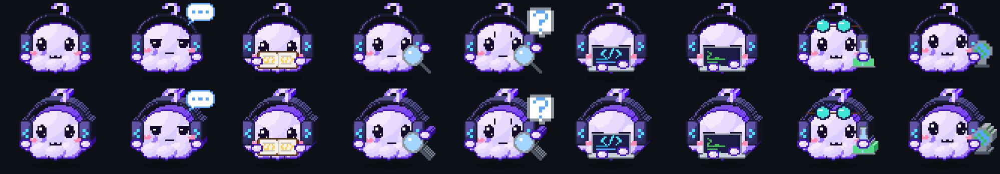

# CodePuff

**An interactive coding pet for Claude Code and OpenAI Codex.**

CodePuff is a small animated companion that reacts to what your coding agent is *really* doing. It reads when the
agent reads, types when the agent edits, watches a little experiment while tests run, celebrates only after a check
really passed, and looks surprised when something really failed. It also keeps useful statistics across sessions,
projects and both agents in **one local history** on your machine.

No account. No web server. No model calls. No telemetry. Counters only: it never stores your prompts, your code, your
commands, your file paths or tool outputs.

> **Status: MVP `0.1.0`, not a production release.** What has and has not been verified in real hosts is listed
> honestly in [docs/STATUS.md](docs/STATUS.md).

## Eight characters

Every character is hi-res pixel art, about 40-55 pixels tall (twice the detail of a classic 16-bit sprite), with the
shading, highlights and expressions of the reference artwork. Each one also has its own way of idling: Foxy sniffs around,
Bot scans, Slime wobbles, Mage sparks, Penny floats, Classic bounces, Alpha waves and Claude shuffles. Foxy's tail, Bot's
antenna, Classic's curl, Mage's star and Penny's fin also sway on their own (faster when the pet is happy).


Top to bottom: **Alpha** (the original CodePuff, redesigned), **Classic** (code cloud with headphones),
**Foxy**, **Bot**, **Slime**, **Mage**, **Penny**, and **Claude** (a boxy orange critter,
an unofficial fan design). Each has its own colors, and any character wears any palette.

## What the pet shows




| State | When (always a real event) |
| --- | --- |
| Idle | Nothing is happening: it rests, blinks, looks around. |
| Thinking | A turn is running and no tool call is in flight. The label says exactly that: *Working on a response*. A thought cloud alternates a light bulb and a turning gear. |
| Reading / Searching | A read, search or inspecting command (`cat`, `rg`, `git diff`, ...) is running: a book (the eyes sweep along the lines and a page turns), or a magnifier. |
| Coding / Running | Editing files: a laptop with a glowing `</>` and code symbols floating up. Running a command: a shell prompt and a spinner. |
| Git / Connected tool | A git command: a commit graph with a branch. A tool from an MCP server: a plug sliding into its socket, with a spark. |
| Testing | A recognized test run is in flight: goggles and a bubbling flask. |
| Success | A test run **confirmed passed** (exit code 0, not hidden by a pipe), or a commit was made: sparkles. |
| Error / Investigating | A tool (or a model request) really failed: a red `!` badge; then *Looking into the failure*. |
| Permission | The agent is waiting for your approval or answer: a yellow `!` badge. It always wins. |
| Subagents | Up to three small helpers appear while subagents are really running. |
| Finished / Waiting | A turn ended: confetti; then it waits for your next prompt with a happy face, then rests. |
| Tired | The plan is nearly used up: 80% or more of the 5-hour, weekly or spending limit, as Claude Code reports it. Half-closed eyes, a yawn, a sweat drop; shown while the pet has nothing else to do. |
| Disconnected | No agent has been heard from: grey, eyes closed. |

When several sessions are active, one deterministic rule decides which one the pet shows (needs you, then a
failure, then live work, then a celebration, then waiting; ties go to the most recent session), and the label always
says which agent and project it is. See [docs/ARCHITECTURE.md](docs/ARCHITECTURE.md).

## Where you see it

| Surface | Claude Code | Codex |
| --- | --- | --- |
| **Compact band above the prompt**: the whole pet at the left edge, what it is doing right now, and at the right edge a pie chart of how this session's tasks went (successes and failures as the agent reported them) with the counts under it; the pet and the pie are the same height, and the band comes in three sizes (small, medium, large) | yes (`/codepuff band on|off|small|medium|large`, or the *Compact band* settings in Customize) | not possible: Codex has no plugin UI |
| **Pane / widget**: the animated pet beside the chat, statistics, customization (Statistics and Customize tabs); click the activity in the compact band to pet it (pat again and again: a pat, a giggle, then overjoyed); the pet hops when the pointer is over it, and pausing on the pet or the pie chart shows a tooltip; a new state arrives with a small pop | yes (desktop widget, docked pane) | not possible |
| **Terminal app** `codepuff pet`: pet, statistics, customization, data | yes | yes (the way to see your pet next to Codex) |
| One-line status under the prompt | yes (`/codepuff line on`) | - |

There is **no web server** and nothing is opened in a browser.

## Install

You need **Node.js 20+** for the Codex side and the terminal app. The Claude Code plugin itself needs only Claude Code.

### Claude Code

```text
/plugin marketplace add luizbizzio/codepuff
/plugin install codepuff@codepuff
```

(Once this repository is public. Until then add your local clone: `/plugin marketplace add <path to the clone>`.
In the desktop app: **+** next to the prompt → **Plugins** → **Add marketplace**.) Start a new session: the compact
band appears above the prompt and the pet shows as a widget. `/codepuff` opens the full pane; `/codepuff help` lists
the options. To try it from a clone without installing: `claude --plugin-dir <path to the clone>`.

### Codex

```text
git clone https://github.com/luizbizzio/codepuff
node codepuff/bin/codepuff.js install codex
```

This adds CodePuff's hooks to your user `hooks.json` (after saving a backup, keeping your own hooks, and changing
nothing if they are already there). **Codex will not run new hooks until you trust them**: in the CLI run `/hooks`
and trust the CodePuff entries; in the desktop app use *Review hooks* or *Settings → Hooks*. CodePuff never edits
trust state itself. Then run the app in a split or a second tab:

```text
node codepuff/bin/codepuff.js pet
```

Optionally put `codepuff` on your PATH with `npm link` inside the clone. The Codex plugin bundle (`.codex-plugin/`,
`codex/hooks.json`, `.agents/plugins/marketplace.json`) is also provided for `codex plugin marketplace add
luizbizzio/codepuff`; it was not installed through Codex in this build's checks ([docs/STATUS.md](docs/STATUS.md)).

**Codex has no supported way for a plugin to draw inside Codex itself**, so CodePuff gives Codex users the terminal
app instead. Codex has its own built-in "Pets"; its docs describe no way for a plugin to drive or customize it, so
CodePuff does not touch it.

### Uninstall

```text
codepuff uninstall codex          # removes only CodePuff's hooks
/plugin uninstall codepuff@codepuff
```

Uninstalling **never deletes your statistics**. `codepuff data delete --yes` does, separately and explicitly.

## The terminal app

`codepuff pet` is a keyboard-driven app with four views: **1 Pet**, **2 Statistics**, **3 Customize**, **4 Data**
(Tab or the number keys switch; `q` quits; `space` pets it). Statistics has a Platform (`a`) and a Period (`s`), the host
first (`codepuff pet --host codex|claude`, otherwise the agent heard from most recently), tiles, a 30-day chart, tool bars and
Claude-vs-Codex bars; `d` shows every number.
Customize uses ↑/↓ to choose and ←/→ to change the character and palette; Enter edits the name. Data exports,
imports and resets. The pet is drawn with half-block characters and **shrinks to fit** your pane (full detail when
there is room). Reduced motion (`codepuff set motion reduced`) stops all animation.

## Hearts

The pet has one to five hearts for you, shown in the compact band and the pane. They are kept with the pet, so they last
between sessions. If you are abusive to the assistant (insults aimed at it, in English or Portuguese; swearing at a bug does
not count) they drop, the pet flinches (*That hurt…*), and with two hearts or fewer it is sad whenever it has nothing else to
do. Thanks bring a heart back, and each day without unkindness heals a little. The text of a prompt is only looked at in
memory to decide this: it is never stored, logged or sent anywhere, only the number is kept. It applies to your Codex
prompts too (the pet is one), and you can turn it off with the *Hearts react to my messages* switch in Customize,
`/codepuff mood off` or `codepuff set mood off`; then nothing is read and the hearts are hidden. The word lists are in
`src/core/mood.js`; they are simple, so an unusual insult can slip by and an odd phrase can be misread.

When it is **waiting for your next prompt** the pet always has a happy face.

## Sounds and milestones

On the desktop the pet can play a short sound at four moments: when Claude **asks you something** (a permission or a
question), when a turn **finishes**, and when your plan's **5-hour** or **weekly** limit **resets** (as Claude Code reports
the limits; a toast says so too). All are on by default. For each, pick one of five sounds (chime, bell, pop, ding, tada) or
off in Customize (the sound plays as you pick it; the first time, a toast says they exist), or with
`/codepuff sound <question|finish|reset5h|resetWeek> <off|chime|bell|pop|ding|tada>` or `codepuff set sound ...`. The volume
is low, medium (the default) or high: `/codepuff volume low`. The clips are synthesized by `scripts/make-sounds.mjs`, so they
are original. Round numbers
(the 100th task, a 7-day streak, 100 passing test runs...) get a toast and a celebration, once each; what was reached
before the feature existed is not announced.

## Your pet

One pet per computer, shared by Claude Code and Codex: its name, character, colors, birthday and lifetime
statistics survive new chats, restarts, switching agents and resuming old conversations.

* **Customize**: pick any of the eight characters, a name (up to 16 characters), 10 palettes plus any
  custom body and accent colors. Colors become five-tone ramps, so shading always
  survives; eyes stay readable on every preset.
* **Reduced motion** is honored (`/codepuff motion reduced`, `codepuff set motion reduced`; the system setting in SVG).
* A click, tap or `space` gives a small reaction. It never sends anything to the agent.
* Pets saved by the first version (the single "Puff") are migrated to **Alpha** automatically.

## Statistics

Pick a **Platform** (Claude Code, Codex or Combined; the one you are in comes first) and then a **Period** (this session,
7 days, 30 days, all time). *This session* is offered only for the platform you are in: for the other one, or for both, there
is no single session to speak of. A new chat starts a fresh session count; lifetime keeps growing; one resumed session is one
session.

The page is built to be glanced at: six tiles (prompts, tool calls with how many succeeded, files changed, commits, tests
passed, agent time), a success bar, a bar chart of the last 14 days (hover a bar for its day), and what the work was made of.
The long list of every number is one button away (*Show all numbers*; `d` in the terminal app). What the list holds:

* Conversation: prompts (not internal requests, retries or subagent turns), agent turns completed, tool calls by
  category, succeeded/failed, sessions, active sessions, distinct projects.
* Coding: distinct files changed, tests executed / passed / failed / unknown, git commits observed, lines added and
  deleted **in those commits** (read once from `git show` after a successful `git commit`, counted once per hash;
  merges and unreadable repositories show **Unavailable**), estimated agent time (gaps over 10 minutes are not counted).
* Time: birthday, age in days, active days, current and longest streak, last active day. A day is active only when
  you actually submitted a prompt that day (local calendar, DST-safe); background events never extend a streak.

Where a number cannot be known it says **Unavailable** or *unknown*; it is never guessed. A test run is "unknown",
not "passed", when its exit code is hidden (for example `npm test | tail`) or unreadable.

## Your data

Everything lives in one folder, `~/.codepuff` (override with `CODEPUFF_HOME`): `pet.json` (identity and look) and
`sessions/<agent>/<id>.json` (one small record per session, about 0.4 to 0.8 KB). They are separate on purpose:
resetting one never touches the other.

```text
codepuff data export [file]          codepuff data import <file> [--replace] [--pet]
codepuff data reset stats --yes      (keeps the pet; saves a safety backup first)
codepuff data reset pet --yes        (new pet, new birthday; keeps statistics)
codepuff set restore                 (default character, name and colors; keeps birthday and statistics)
codepuff data delete --yes           (deletes everything, explicitly)
codepuff set character fox | band off | palette mint | name Biscuit | motion reduced
```

The same controls are in the terminal app's *Data* view and, in Claude Code, as `/codepuff export | import | reset`.
Backups are plain, versioned JSON; imports are validated field by field and never lower a count, so importing the
same backup twice changes nothing. Damaged files are moved aside (never deleted silently) and repaired.

## How it stays light

No polling when idle; no model calls; no network; no server. Claude Code's hooks only update memory (a few
microseconds per event) and a debounced write; the desktop picture is an SVG animated by CSS; the terminal animation
steps frames only while it is drawn and only when the next frame is due. Measured numbers, methods and caveats:
[docs/PERFORMANCE.md](docs/PERFORMANCE.md).

## Develop

```text
npm test                    # 140+ tests, no dependencies
claude plugin validate .    # and: claude plugin test .   (Claude Code 2.1.275+)
node scripts/bench.mjs      # measures the overhead on your machine
node scripts/live-codex.mjs # ONE tiny real Codex run to check the hooks (uses a little Codex usage)
node scripts/preview.mjs    # contact sheets: all characters, or `preview.mjs 3 fox` for every state of one
```

* [docs/ARCHITECTURE.md](docs/ARCHITECTURE.md): how it is built, the data model, concurrency, adding a character.
* [docs/PLATFORMS.md](docs/PLATFORMS.md): what Claude Code and Codex expose, and what only one of them can do.
* [docs/STATUS.md](docs/STATUS.md): what was verified where, known limitations, what comes next.

## License

Apache License 2.0. See [LICENSE](LICENSE) and [NOTICE](NOTICE). CodePuff is independent and not affiliated with
Anthropic or OpenAI. Alpha is drawn in code and "Claude" is an unofficial fan design; the six other characters are
pixel-art conversions of character sheets supplied by the project owner (see [NOTICE](NOTICE)).
