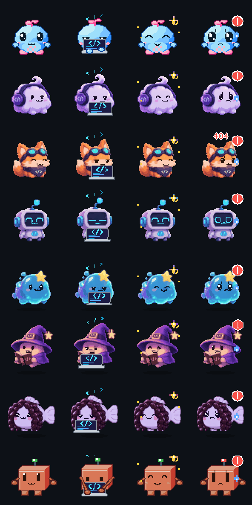
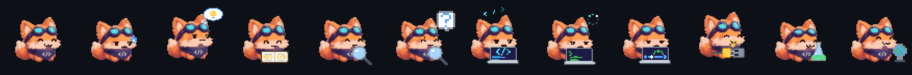
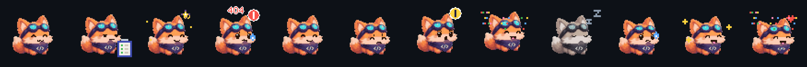

# Features

Everything CodePuff does, in detail. The short version is in the [README](../README.md); how it is built is in
[ARCHITECTURE.md](ARCHITECTURE.md); what was verified where is in [STATUS.md](STATUS.md).

## The characters

Every character is hi-res pixel art, about 40-55 pixels tall (twice the detail of a classic 16-bit sprite), with the
shading, highlights and expressions of the reference artwork. Each one also has its own way of idling: Foxy sniffs around,
Bot scans, Slime wobbles, Mage sparks, Penny floats, Classic bounces, Alpha waves and Claude shuffles. Foxy's tail, Bot's
antenna, Classic's curl, Mage's star and Penny's fin also sway on their own (faster when the pet is happy).



Top to bottom: **Alpha** (the original CodePuff, redesigned), **Classic** (a code cloud with headphones), **Foxy**, **Bot**,
**Slime**, **Mage**, **Penny** and **Claude** (a boxy orange critter, an unofficial fan design). Each has its own colors, and any
character wears any palette. Foxy also floats a `404` over its head when something fails.

Every animation of each character, and when it appears: [Alpha](characters/alpha.md), [Classic](characters/classic.md),
[Foxy](characters/fox.md), [Bot](characters/bot.md), [Slime](characters/slime.md), [Mage](characters/mage.md),
[Penny](characters/aquatic.md), [Claude](characters/claude.md).

## What the pet shows




| State | When (always a real event) |
| --- | --- |
| Idle | Nothing is happening: it rests, blinks, looks around. |
| Bored / Coffee break / Napping | Nothing happens for a while. After about five minutes it looks around, yawns and taps a foot; after ten it has a coffee, steam rising; after a quarter of an hour it naps. Any event wakes it. |
| Thinking | A turn is running and no tool call is in flight. The label says exactly that: *Working on a response*. A thought cloud alternates a light bulb and a turning gear. |
| Reading / Searching | A read, search or inspecting command (`cat`, `rg`, `git diff`, ...) is running: a book (the eyes sweep along the lines and a page turns), or a magnifier. |
| Coding / Running | Editing files: a laptop with a glowing `</>` and code symbols floating up. Running a command: a shell prompt and a spinner. |
| Git / Connected tool | A git command: a commit graph with a branch. A tool from an MCP server: a plug sliding into its socket, with a spark. |
| Testing | A recognized test run is in flight: a bubbling flask. |
| Success | A test run **confirmed passed** (exit code 0, not hidden by a pipe), or a commit was made: sparkles. |
| Error / Investigating | A tool (or a model request) really failed: a red `!` badge that stays put (it does not blink), and a `404` floating over Foxy's head (only Foxy's); then *Looking into the failure*. |
| Permission | The agent is waiting for your approval or answer: a yellow `!` badge. It always wins. |
| Subagents | Up to three small helpers appear while subagents are really running. |
| Finished / Waiting | A turn ended: confetti; then it waits for your next prompt with a happy face, then rests. |
| Tired | The plan is nearly used up: 80% or more of the 5-hour, weekly or spending limit, as Claude Code reports it. Half-closed eyes, a yawn, a sweat drop; shown while the pet has nothing else to do. |
| Disconnected | No agent has been heard from: grey, eyes closed. |
| Greetings | When a Claude Code session starts, or you come back to it after three hours away, the pet greets you for a couple of seconds in a way that fits the time of day: a stretch and a yawn under the sun in the morning, a hop and a wave in the afternoon, a calm wave under the moon in the evening, a big yawn under the stars late at night. They give way to anything the agent is doing. |
| Stretch | The break reminder (below). |

**On Codex** the pet shows what Codex reports. The Codex build checked (0.171) sends no completion for a tool call, so tool calls
are counted with an unknown outcome: no success or failure animation, test result or commit count for Codex until the host sends
it (see [STATUS.md](STATUS.md)).

When several sessions are active, one deterministic rule decides which one the pet shows (needs you, then a
failure, then live work, then a celebration, then waiting; ties go to the most recent session), and the label always
says which agent and project it is. See [ARCHITECTURE.md](ARCHITECTURE.md).

## Where you see it

| Surface | Claude Code | Codex |
| --- | --- | --- |
| **Compact band above the prompt**: the whole pet at the left edge; next to it the streak, this session's prompts and, when Claude Code reports one, the session's estimated cost (`🔥 3 days · 💬 139 prompts · 💵 $0.14`), a status block whose dot and outline take the color of what is going on (green well, amber needs you or worn out, red failed, blue working) with the hearts under it, and, as a thin strip of its own under the band and next to the prompt, the plan's limits (see below); at the right edge a ring of how this session's tasks went (success rate in the middle, counts under it, a tooltip with the numbers). Three sizes (small, medium, large), and the text beside the pet is scaled down together with it (the type size, the air between the lines and the hearts), with the same layout at every size, so the band can be as short as the pet | yes (`/codepuff band on|off|small|medium|large`, or the *Compact band* setting in Settings) | not possible: Codex has no plugin UI |
| **Pane / widget**: the animated pet beside the chat, statistics, customization (four tabs, shown as an emoji each so they fit on one line: 📊 Statistics, 🎨 Customize, 🏆 Achievements and ⚙️ Settings; every page is titled with its name); click the activity in the compact band to pet it (pat again and again: a pat, a giggle, then overjoyed); the pet hops when the pointer is over it, and pausing on the pet or the pie chart shows a tooltip; a new state arrives with a small pop | yes (desktop widget, docked pane) | not possible |
| **Terminal app** `codepuff pet`: pet, statistics, customization, data | yes | yes (the way to see your pet next to Codex) |
| One-line status under the prompt: the pet and what it is doing, then the context used, the 5-hour and weekly limits and the session's cost when Claude Code reports them (`Penny · Coding · ctx 62% · 5h 24% · week 31% · $0.31`) | yes (`/codepuff line on`) | - |

## The plan's limits and the session's cost

Under the band, a thin strip shows how much of your plan's **5-hour** and **weekly** limits is used, as bars (green, amber from 70%, red from 90%) with the time to reset ("resets in 4h 20m", and from a day on "6d 9h"). It is a line of its own, above the prompt, with a faint rule between it and the band. Choose what it shows in Settings, or with `/codepuff plan <auto|always|five_hour|seven_day|off>`:

* **always** (the default): both windows, whatever they are at;
* **auto**: the windows that are half used or more, so the strip appears only when it matters;
* **five_hour** or **seven_day**: only that window, always (a note says so if Claude Code reports none yet);
* **off**: never.

The figures are what Claude Code reports after its first response of the session. They are read once a minute and nothing is stored.

The **session cost** next to the prompt count, and as a tile and a row in *Statistics > This session*, is the number Claude Code's own `/cost` shows: an estimate from token counts at list price, **not the bill** (on a subscription, usage inside the plan is not billed in dollars at all). It is only for the current session, and it is left out (never shown as zero) when the host reports none.

## Settings: the defaults, and what is shared

Everything starts with these values, with nothing to set up. All of it is saved in one file, `~/.codepuff/pet.json`, which **Claude Code and
Codex both read and write**: change something in the Claude Code pane and the Codex terminal app shows it (and the other way round). Some settings
only do anything in Claude Code (the band, the sounds), because that is where they are drawn; they are saved in the shared file anyway.

| Setting | Default | Change it | Used in |
| --- | --- | --- | --- |
| Character | **Classic** | Customize · `/codepuff character fox` · `codepuff set character fox` | both |
| Name | none (the character's own name is shown) | Customize · `/codepuff name Biscuit` | both |
| Colors | the character's own | Customize · `/codepuff palette mint` | both |
| Motion | **Calm** (Full, Calm, Still; `reduced` on the command line) | Settings · `/codepuff motion full` | Claude Code (the terminal app has its own reduced-motion switch) |
| Compact band | **on**, size **large** (small, medium, large) | Settings · `/codepuff band large` | Claude Code |
| Status line under the prompt (the pet, what it is doing, context, limits, cost) | **on** | Settings · `/codepuff line on` | Claude Code |
| Hearts (the pet reacts to my messages) | **on** | Settings · `/codepuff mood off` | both |
| Sounds | asks you something: **pop**; finishes: **tada**; 5-hour limit resets: **chime**; weekly limit resets: **chime** (each can be off) | Settings · `/codepuff sound finish off` | Claude Code desktop |
| Sound volume | **low** (low, medium, high) | Settings · `/codepuff volume low` | Claude Code desktop |
| Language | **Automatic** (the computer's language; English when it is not one of the 14) | Settings · `/codepuff language pt-BR` · `codepuff set language pt-BR` | both |
| Hearts | 5 of 5 | they move with how you treat the assistant | both |
| Statistics page | platform: **the one you are in**; period: **this session** | the buttons on the page (not saved) | both |

Shared too: the statistics. Each session of each agent has its own small file in `~/.codepuff/sessions/<agent>/`, and the statistics page adds
them up, so *Combined* is simply both. What is **not** shared between the two is only what each host can show: Claude Code has the band and the
pane, Codex has the terminal app.

Two things happen once, on the first run in Claude Code: a toast says that sounds exist and where to change them, and the milestones already
reached (if you have history) are recorded without a celebration.

## Languages

Everything CodePuff says is translated, and it **picks the language of your computer by itself**: the band, the pane, the statistics,
the toasts, the answers of `/codepuff`, the terminal app and the statistics of `codepuff stats`. Anything else falls back to English.

English (`en`), Português do Brasil (`pt-BR`), Español (`es`), Français (`fr`), Deutsch (`de`), Italiano (`it`), Nederlands (`nl`), Polski (`pl`), Türkçe (`tr`), Русский (`ru`), 日本語 (`ja`), 한국어 (`ko`), 简体中文 (`zh-CN`) and 繁體中文 (`zh-TW`).

To choose another one, use the **Language** buttons in Settings (`Automatic` follows the computer), `/codepuff language de`, or
`codepuff set language de`. The choice is saved with the pet, so Claude Code and Codex show the same language. How "automatic" finds
the language: `CODEPUFF_LANG` if set (useful to force one: `CODEPUFF_LANG=ja codepuff pet`), then the system's interface language
(on Windows) or `LC_ALL` / `LC_MESSAGES` / `LANGUAGE` / `LANG` (elsewhere), then the browser-style locale of the runtime.

What stays in English on purpose: the names of the characters, the words of the commands (`/codepuff band large` is the same in every language, so
the documentation is true in all of them), `Claude Code` and `Codex`, the word `DELETE` typed to confirm deleting your data, and the
output of `codepuff doctor`, `install` and `help`. Numbers, dates and durations follow the language (1.234 in German, 1 234 in
French, 11月24日 in Japanese), and the plural forms follow its grammar (Russian and Polish have three).

The translations were written by the project, not by native speakers of every language, so some phrasing will not be perfect: please
tell us, or fix it (see [CONTRIBUTING.md](../CONTRIBUTING.md)).

## Hearts

The pet has one to five hearts for you, shown in the compact band and the pane. They are kept with the pet, so they last
between sessions. If you are abusive to the assistant (insults aimed at it, in any language the pet speaks; swearing at a bug does
not count) they drop; harsh criticism ("your code is garbage") only makes it flinch for a moment and costs nothing. When they drop, the pet flinches (*That hurt…*), and with two hearts or fewer it is sad whenever it has nothing else to
do. Thanks bring a heart back, and each day without unkindness heals a little. The text of a prompt is only looked at in
memory to decide this: it is never stored, logged or sent anywhere, only the number is kept. It applies to your Codex
prompts too (the pet is one), and you can turn it off with the *Hearts* switch in Settings,
`/codepuff mood off` or `codepuff set mood off`; then nothing is read and the hearts are hidden. The word lists are in
`src/core/mood.js`; they are simple, so an unusual insult can slip by and an odd phrase can be misread. English and Portuguese have
the longest lists; the other languages have the common words and phrases (and, for the languages that change their words, the
commonest forms), so they catch less. [MOOD-REVIEW.md](MOOD-REVIEW.md) lists every word per language, so a native speaker can check them and say what is wrong.

When it is **waiting for your next prompt** the pet always has a happy face.

## Sounds and milestones

On the desktop the pet can play a short sound at four moments: when Claude **asks you something** (a permission or a
question), when a turn **finishes**, and when your plan's **5-hour** or **weekly** limit **resets** (as Claude Code reports
the limits; a toast says so too). All are on by default. For each, pick one of five sounds (chime, bell, pop, ding, tada) or
off in Settings (the sound plays as you pick it; the first time, a toast says they exist), or with
`/codepuff sound <question|finish|reset5h|resetWeek> <off|chime|bell|pop|ding|tada>` or `codepuff set sound ...`. The volume
is low (the default), medium or high: `/codepuff volume low`. The clips are synthesized by `scripts/make-sounds.mjs`, so they
are original. Round numbers
(the 100th task, a 7-day streak, 100 passing test runs...) get a toast and a celebration, once each; what was reached
before the feature existed is not announced.

## Achievements and rewards

The **Achievements** tab (next to Statistics and Customize) has one card for each thing that is counted: tasks, days in a row, prompts, passing test runs, commits, files changed, lines added in commits, active days, hours of work, helpers (subagents) called and projects. Each is a game-style badge that **levels up**: a bronze medal at the first goal, then silver, gold and (for tasks) diamond as the count passes each next goal; grey with a padlock until the first. The card shows the metals reached so far and a progress bar toward the next one. Nothing is handed out for free: every goal is a real count, and **every level unlocks something**: an accessory for the pet to wear, a color palette, or a frame for the pet card (the table below says which).

<!-- achievements:start (generated by scripts/badges.mjs) -->

| Badge | Achievement | Metal | Unlocks |
| --- | --- | --- | --- |
|  | 100 tasks done together! | bronze | Flower (accessory) |
|  | 500 tasks done together! | silver | Sunset (palette) |
|  | 1000 tasks done together! | gold | Sunglasses (accessory) |
|  | 5000 tasks done together! | diamond | Rainbow (frame) |
|  | 3-day streak! | bronze | Bow (accessory) |
|  | 7-day streak! | silver | Lemon (palette) |
|  | 30-day streak! | gold | Crown (accessory) |
|  | 100 prompts so far! | bronze | Party hat (accessory) |
|  | 500 prompts so far! | silver | Top hat (accessory) |
|  | 10 passing test runs! | bronze | Glasses (accessory) |
|  | 100 passing test runs! | silver | Ocean (palette) |
|  | 10 commits together! | bronze | Cap (accessory) |
|  | 50 commits together! | silver | Halo (accessory) |
|  | 10 files changed together! | bronze | Beret (accessory) |
|  | 100 files changed together! | silver | Berry (palette) |
|  | 500 files changed together! | gold | Chef hat (accessory) |
|  | 2000 files changed together! | diamond | Pixel (frame) |
|  | 1000 lines added in commits! | bronze | Monocle (accessory) |
|  | 10000 lines added in commits! | silver | Ember (palette) |
|  | 100000 lines added in commits! | gold | Neon (frame) |
|  | 7 active days! | bronze | Bunny ears (accessory) |
|  | 30 active days! | silver | Aurora (palette) |
|  | 100 active days! | gold | Pirate hat (accessory) |
|  | 365 active days! | diamond | Gold (frame) |
|  | 10 hours of work together! | bronze | Cowboy hat (accessory) |
|  | 50 hours of work together! | silver | Cotton candy (palette) |
|  | 200 hours of work together! | gold | Ocean (frame) |
|  | 10 helpers called! | bronze | Viking helmet (accessory) |
|  | 50 helpers called! | silver | Graphite (palette) |
|  | 200 helpers called! | gold | Sunset (frame) |
|  | 3 projects together! | bronze | Graduation cap (accessory) |
|  | 10 projects together! | silver | Galaxy (palette) |
|  | 25 projects together! | gold | Aurora (frame) |

<!-- achievements:end -->

In Customize everything that can be earned is listed, and what is not earned yet is a dim button with a padlock that does nothing:

* **Accessories** (17: flower, bow, glasses, cap, party hat, top hat, sunglasses, crown, halo, beret, chef hat, monocle, bunny ears, pirate hat, cowboy hat, Viking helmet, graduation cap): put one on under *Accessory*, or with `/codepuff accessory <id|none>`. It sits on the head or the face of every character, in every state (the band, the pane and the terminal app all show it).
* **Color palettes** (9 of the 14 have to be earned: sunset, lemon, ocean, berry, ember, aurora, cotton candy, graphite and galaxy; original, sky, marshmallow, mint and lavender are free from the start): under *Colors*, or `/codepuff palette <id>`. A custom color in hex is always free.
* **Band frames** (7: rainbow, pixel, neon, gold, ocean, sunset, aurora): under *Band Frame*, or `/codepuff frame <id|none>`. The one you pick frames the compact band at once (there is no other switch: choose *None* to turn it off), and it is also the frame of the pet card (below). The band is made of the host's boxes, which have one solid color for their border, so there it shows the frame's main color and background rather than a gradient.

A toast tells you when something unlocks. `/codepuff achievements` prints the achievements as text. What a pet had reached before a reward existed is unlocked from the start, without a toast.

## The break reminder

Off by default, and you set both numbers yourself:

* **How often**: from 15 minutes to 8 hours. In Settings (*Break reminder*) pick a preset (30 min, 45 min, 1h, 1h 30m, 2h, 3h, 4h) or move it by 15 minutes with the − and + buttons; or `/codepuff breaks <off|45m|1h|1h30|90>` (minutes, hours, or both: `45`, `45m`, `1h`, `1.5h`, `1h30`).
* **What counts as a break**: a pause of at least this long (5 to 60 minutes, 10 by default) ends a stretch of work and starts the count again. Pick it in Settings or with `/codepuff breakrest 20`.

After the chosen time of work with no such pause, the pet stretches and a message suggests a break ("You have been at it for 2h 05m without a break"). It asks again after another stretch if you carry on. It only looks at when events happen, in memory: nothing is stored.

## The pet card

The **📸** button at the right of the tabs (a message says where it was saved), or `/codepuff card`, writes an animated SVG with the pet (wearing what it wears), its name, how long you have been together, the streak, the hearts and a few totals to the `cards` folder of the data folder. It holds only what the pet shows anyway: no project names, paths or prompts. Open it in a browser (it animates) or take a screenshot to share.

## Your pet

One pet per computer, shared by Claude Code and Codex: its name, character, colors, birthday and lifetime
statistics survive new chats, restarts, switching agents and resuming old conversations.

* **Customize**: pick any of the eight characters, a name (up to 16 characters), 14 palettes (9 of them earned with achievements) plus any
  custom body and accent colors. Colors become five-tone ramps, so shading always
  survives; eyes stay readable on every preset.
* **Motion** has three levels in Settings: *Full* (the pet sways about twice as far to the sides), *Calm* (the default) and *Still* (reduced motion: no animation, no hop under the pointer, no pop when the state changes). Also `/codepuff motion full|calm|reduced`, `codepuff set motion ...`, and the system's own reduced-motion setting. Sounds are not affected.
* A click, tap or `space` gives a small reaction. It never sends anything to the agent.
* Pets saved by the first version (the single "Puff") are migrated to **Alpha** automatically.

## Statistics

Pick a **Platform** (Claude Code, Codex or Combined; the one you are in comes first) and then a **Period** (this session,
7 days, 30 days, all time). *This session* is offered only for the platform you are in: for the other one, or for both, there
is no single session to speak of. A new chat starts a fresh session count; lifetime keeps growing; one resumed session is one
session.

The page is built to be glanced at: which days it covers, six tiles (prompts, tool calls with how many succeeded, files changed,
commits, test runs with how they ended, agent time), a success bar, a bar chart of the last 14 days (hover a bar for its day;
under it the first day, today and the busiest day), and what the work was made of. A test run whose result could not be read
(a piped command hides its exit code) is shown as *unconfirmed*: not a pass, not a failure.
The long list of every number is one button away (*Show all numbers*; `d` in the terminal app). What the list holds:

* Conversation: prompts (not internal requests, retries or subagent turns), agent turns completed, tool calls by
  category, succeeded/failed, sessions, active sessions, distinct projects.
* Coding: distinct files changed, tests executed / passed / failed / unknown, git commits observed, lines added and
  deleted **in those commits** (read once from `git show` after a successful `git commit`, counted once per hash;
  merges and unreadable repositories show **Unavailable**), estimated agent time (gaps over 10 minutes are not counted).
* Time: birthday, age in days, active days, current and longest streak, last active day. A day is active only when
  you actually submitted a prompt that day (local calendar, DST-safe); background events never extend a streak.

Where a number cannot be known it says **Unavailable** or *unknown*; it is never guessed. A test run is "unknown",
not "passed", when its exit code is hidden (for example `npm test | tail`) or unreadable.

## The terminal app

`codepuff pet` is a keyboard-driven app with four views: **1 Pet**, **2 Statistics**, **3 Customize**, **4 Data**
(Tab or the number keys switch; `q` quits; `space` pets it). Statistics has a Platform (`a`) and a Period (`s`), the host
first (`codepuff pet --host codex|claude`, otherwise the agent heard from most recently), tiles, a 30-day chart, tool bars and
Claude-vs-Codex bars; `d` shows every number.
Customize uses ↑/↓ to choose and ←/→ to change the character and palette; Enter edits the name. Data exports,
imports and resets. The pet is drawn with half-block characters and **shrinks to fit** your pane (full detail when
there is room). Reduced motion (`codepuff set motion reduced`) stops all animation.

## Your data

Everything lives in one folder, `~/.codepuff` (override with `CODEPUFF_HOME`): `pet.json` (identity and look) and
`sessions/<agent>/<id>.json` (one small record per session, about 0.4 to 0.8 KB). They are separate on purpose:
resetting one never touches the other.

```text
codepuff data export [file]          codepuff data import <file> [--replace] [--pet]
codepuff data reset stats --yes      (keeps the pet; saves a safety backup first)
codepuff data reset pet --yes        (new pet, new birthday; keeps statistics)
codepuff set restore                 (default character, name and colors; keeps birthday and statistics)
codepuff data delete --yes           (deletes everything, explicitly)
codepuff set character fox | band off | palette mint | name Biscuit | motion reduced
```

The same controls are in the terminal app's *Data* view and, in Claude Code, as `/codepuff export | import | reset`.
Backups are plain, versioned JSON; imports are validated field by field and never lower a count, so importing the
same backup twice changes nothing. Damaged files are moved aside (never deleted silently) and repaired.
