# Claude

A boxy orange pixel critter. Unofficial fan design.

[All characters](../../README.md#what-you-see) · [Features](../FEATURES.md)

## Every animation

All the pictures are animated. Each one shows when it appears, for Claude and for every other character: the states follow what the agent really does, and the last four are reactions to you.

| Picture | Animation | When it appears |
| --- | --- | --- |
|  | **Idle** | Nothing is happening: the agent is not working. |
|  | **Thinking** | The agent is working on a response and no tool call is in flight. |
|  | **Reading** | The agent is reading files. |
|  | **Searching** | The agent is searching the project. |
|  | **Investigating** | The agent reads or searches right after something failed: it is looking into the failure. |
|  | **Coding** | The agent is editing code. |
|  | **Running** | A command is running. |
|  | **Git** | A git command: a commit, a branch, a push. |
|  | **Connected tool** | A tool from an MCP server is being used. |
|  | **Testing** | A recognized test run is in flight. |
|  | **Web** | The agent is looking things up online. |
|  | **Subagents** | Subagents are working: small helpers appear next to the pet. |
|  | **Planning** | The agent is updating its plan. |
|  | **Success** | A test run was confirmed passed, or a commit was made. |
|  | **Error** | Something really failed: a tool, the tests or the model request. |
|  | **Needs you** | The agent needs you: an approval or a question. |
|  | **Waiting** | The turn is done and the agent waits for your next prompt. |
|  | **Finished** | The turn has just ended. |
|  | **Tired** | Your plan's limit is nearly used up. |
|  | **Sad** | The pet's hearts are low (it did not like what it was told). |
|  | **Disconnected** | No agent is connected, or the session ended. |
|  | **Petted** | You pressed the pet. |
|  | **Giggle** | You pressed the pet several times. |
|  | **Delighted** | You pressed the pet a lot, or thanked it. |
|  | **Hurt** | Someone was rude to it. Hearts recover with time and kind words. |

Generated by <code>scripts/characters.mjs</code>: the same pictures the Claude Code band draws.
